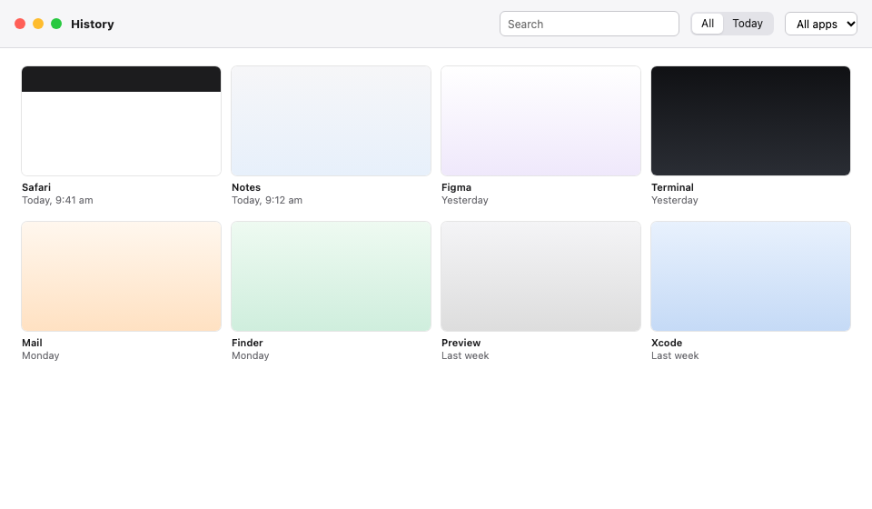
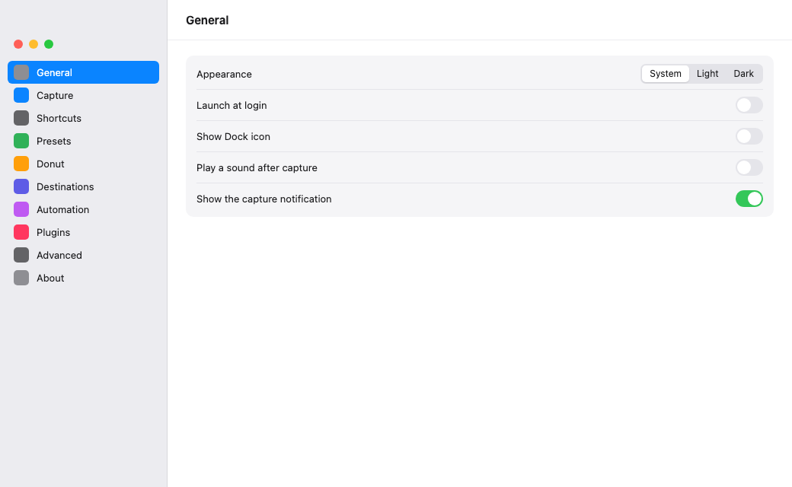

<div align="center">


# Shotsmith

A free, open-source screenshot tool for the Mac menu bar.

[](LICENSE)


[Releases](https://github.com/Smithey/shotsmith/releases) · [Website](https://shotsmith.app) · [Roadmap](docs/ROADMAP.md) · [Contributing](CONTRIBUTING.md)


</div>

Shotsmith 0.1 is a menu bar app for macOS 14 and newer. Press the shortcut, drag a region, and the capture is on the clipboard and in History. You can annotate it, save a PNG, or pin it above your other windows.

This repository is the whole free app, under the MIT licence. Nothing in it is a trial, and nothing here will be moved behind a paywall.

Releases also include a Windows 11 64-bit installer. That build is not Authenticode signed yet, so Windows SmartScreen may warn until you confirm the checksum below.

## A note from me

Yes, I did vibe code this, and I am by no means a software engineer. If you think you can do it better, then go ahead. I am not stopping you. If you want to contribute, feel free, but unless you understand the output and test it, don't be a meat proxy ([dontbeameatproxy.com](https://dontbeameatproxy.com)).

I built this for my own use because I really loved Greenshot in my Windows days. I am not a fan of the Mac app, and the built-in Mac screenshot tool was annoying to use. My uncle asked for a free Snagit alternative.

I did get inspiration for the action wheel from [Filee](https://github.com/KnifeLemon/Filee). I am sure their designers think I butchered the look, but props to them for the awesome app.

I benefit from open source software, directly and indirectly, every day, so I wanted to do the same. It was a tough decision to go with open-core, but I was satisfied because everything I would have wanted, plus more, is free forever. The paid version, which is dirt cheap, is basically like 2% of obscure features that really are more for people who want to go out of their way to support me to keep improving this. I am just happy if one other person benefits from it.

My job (Senior Technical Support Engineer) has, for 10+ years, required me to take, mark up, and send screenshots to thousands or tens of thousands of people, and it has always taken more time than it should have.

I have never written a line of code in Rust in my life. I hear it is fast. I don't know. I am not a software engineer.

## In this version



- **Capture.** Region, window, full screen, scrolling, repeat the last region, and a timer. A loupe helps line up the region. Copy text from a region. Measure an element, or the distance between two clicks.
- **Donut.** After a capture, a wheel at the cursor can copy, save, share, print, open the editor, or pin. VoiceOver and Narrator get the same actions as a normal menu.
- **Editor.** Select, crop, arrow, rectangle, ellipse, line, freehand, text, callout, step counter, highlight, obfuscate, magnify, and an eyedropper. Shapes stay editable after you place them, including after you close the window. Undo and redo. Copy, Save PNG, and Save As. Selectable text, copy as code, and Look Up on Mac.
- **Obfuscate.** Pixelate, blur, or a solid block, drawn by hand. A scan can mark emails, phone numbers, addresses, card numbers, IBANs, and API keys. You redact the ones you keep.
- **Beautify.** Size, backdrop, frame, padding, radius, shadow, and a plain text watermark.
- **Presets.** Format, scale, folder, and a file name pattern. The default preset is what Save uses.
- **History and pins.** Searchable history, including text from a capture. Editing a capture updates its thumbnail. Pins float a capture above other windows.
- **Share, print, and Open in.** The Mac share sheet and the Windows share window. Each system's print dialog, with fit and rotate. Open in lists installed apps and remembers recent ones.
- **Automation.** A `shotsmith` command, `shotsmith://` links, and watch folders. Apple Shortcuts can open a link on Mac. That row is not in Windows Settings.
- **Settings.** General, Capture, Shortcuts, Presets, Donut, Destinations, Automation, Plugins, Advanced, and About. Shortcuts are click-to-record. Appearance follows the system, or you can lock light or dark. Plugins stay off until you turn them on. Update checks stay off until you turn them on.
- **Several editors.** Each capture opens its own window. On Mac, right-click the Dock icon to move between Settings, History, and the editors.



## Not in this version

These stay out of the free app:

- Face detection and automatic redaction
- Translate, contrast checking, and style-kit watermarks
- HEIC export. The format is listed, and this build rejects it on Mac and Windows.
- Account, checkout, and share links

## Shotsmith Pro

Pro is **not for sale**. There is no account, no trial, and no checkout.

It will be optional, and it will live in a separate private repository. Official builds can include it later. A build you make from this repository is the free app only.

What Pro is for, once it exists:

- Share links you can expire or password-protect
- A step-by-step guide recorder
- Redaction that finds faces and secrets for you
- Snapping to elements on screen, visual diff, and search across your captures
- Translate, alt text, and shared style kits
- Teams: shared kits and one invoice

Pricing is not final. The working figure is about $3.99 a month or $36 a year, with a discount for teams, but nothing is being charged yet.

## Shortcuts

| Action | Mac | Windows |
|---|---|---|
| Region | `⌘⇧2` | `Ctrl+Shift+2` |
| Repeat last region | `⌘⇧1` | `Ctrl+Shift+1` |
| Window | `⌥⌘⇧2` | `Ctrl+Alt+Shift+2` |
| Full screen | `⌃⌘⇧2` | `Ctrl+Win+Shift+2` |
| History | `⌘Y` | `Ctrl+H` |

You can change these in Settings.

## Privacy

The free app does not send telemetry. Text recognition and the secret scan run on your computer. An update check runs only after you turn it on in Settings, and then it only asks GitHub which release is current. A plugin you turn on can upload a capture. Settings shows what each plugin says it uploads. See [PRIVACY.md](PRIVACY.md).

On first launch, macOS asks for Screen Recording. Some actions also need Accessibility. Both stay in System Settings, Privacy & Security.

## Install

Signed downloads will appear on [Releases](https://github.com/Smithey/shotsmith/releases) after a push to `main`, once the Apple signing secrets below are set. Until then, build it yourself. An ad-hoc build opens on the Mac that built it. Other Macs will refuse it until it is signed with a Developer ID and notarized.

```sh
git clone https://github.com/Smithey/shotsmith.git
cd shotsmith
pnpm install
pnpm tauri build
open target/release/bundle/macos/Shotsmith.app
```

You need Rust (stable), Node.js 20 or newer, pnpm, and the [Tauri 2 prerequisites](https://v2.tauri.app/start/prerequisites/). The disk image is written to `target/release/bundle/dmg/`.

## Signing releases

Other Macs only open the app if it is signed with a **Developer ID Application** certificate and notarized by Apple. That needs:

1. An [Apple Developer Program](https://developer.apple.com/programs/) membership ($99 a year). An iOS distribution certificate is a different certificate and is not used here.
2. A **Developer ID Application** certificate, created for the same team, exported as a `.p12` (certificate plus private key).
3. An app-specific password for your Apple ID, from [account.apple.com](https://account.apple.com), so the release job can notarize. An App Store Connect API key works instead.
4. These [Actions secrets](https://github.com/Smithey/shotsmith/settings/secrets/actions) on this repository:

| Secret | Value |
|---|---|
| `APPLE_CERTIFICATE` | The `.p12` file, base64-encoded (`base64 -i Certificate.p12`) |
| `APPLE_CERTIFICATE_PASSWORD` | Password for that `.p12` |
| `APPLE_SIGNING_IDENTITY` | `Developer ID Application: Your Name (TEAMID)` |
| `APPLE_TEAM_ID` | The 10-character Team ID |
| `APPLE_ID` | The Apple ID email |
| `APPLE_PASSWORD` | The app-specific password |

A push to `main` builds an Apple silicon disk image and a Windows 11 64-bit installer, then attaches both to a GitHub Release. The Mac image is signed and notarized when those secrets exist. Without them, that image is only ad-hoc signed.

The Windows installer is Authenticode signed when `WINDOWS_CERTIFICATE` (a base64 `.pfx`) and `WINDOWS_CERTIFICATE_PASSWORD` are set. Otherwise it stays unsigned.

`cargo build -p shotsmith-cli` builds the `shotsmith` command. `packaging/bin/shotsmith` runs it. The Homebrew cask and winget manifest are in `packaging/`. Paste the checksums from `SHA256SUMS` before you publish those.

## Check a download

Each release includes `SHA256SUMS`, and the workflow publishes a GitHub build attestation for the installers.

On a Mac, from the folder where you downloaded the release files:

```sh
shasum -a 256 -c SHA256SUMS
gh attestation verify Shotsmith_0.1.0_aarch64.dmg --repo Smithey/shotsmith
```

On Windows, in PowerShell:

```powershell
Get-FileHash .\Shotsmith_0.1.0_x64-setup.exe -Algorithm SHA256
```

Match that hash to the line for the same file in `SHA256SUMS`. The checksum and the attestation show that the file is the one this workflow built. Use the file name from the release if the version in the example has moved on.

## Contributing

Pull requests are welcome from anyone. `main` only changes through a pull request, and it needs a review from [@Smithey](https://github.com/Smithey) before it merges.

Bug reports, translations, docs, and code all fit. Read [CONTRIBUTING.md](CONTRIBUTING.md). Commits need a [Developer Certificate of Origin](https://developercertificate.org/) sign-off (`git commit -s`).

```sh
cargo test --workspace
pnpm typecheck
```

## Licence

The app in this repository is [MIT](LICENSE). Shotsmith Pro is not in this repository. “Shotsmith” and the anvil logo are trademarks of their owner.
