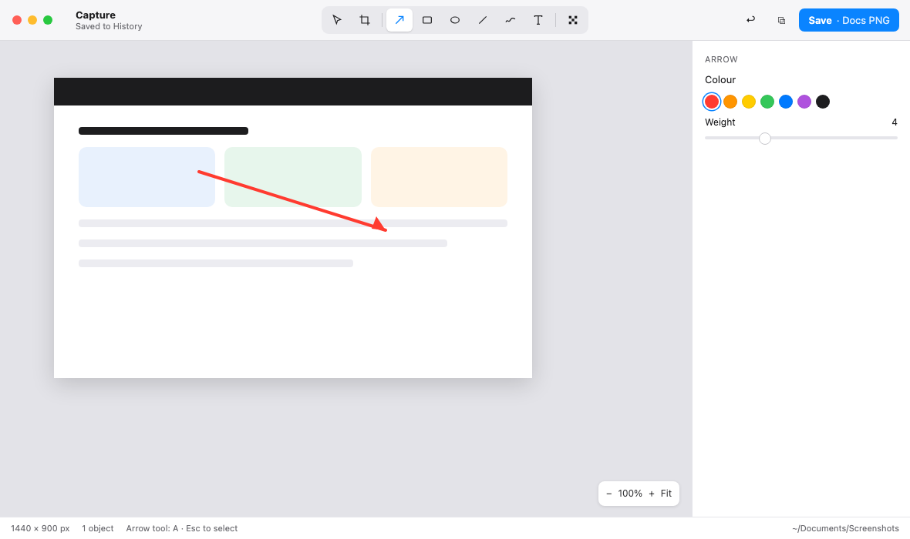

<div align="center">


# Shotsmith

**Screenshots, forged in two keystrokes.**
The free, open-source screenshot and annotation tool for **Mac and Windows**.

[](LICENSE)


[](#free-forever)

[Download](https://github.com/Smithey/shotsmith/releases) · [Website](https://shotsmith.app) · [Docs](docs/) · [Roadmap](#roadmap) · [Contributing](CONTRIBUTING.md)



</div>

---

## Why Shotsmith?

- **Free forever.** Every core feature, no trial, no watermark, no account.
- **Private by default.** No telemetry, no network calls, works fully offline.
- **Fast.** Hotkey → capture → copied in two keystrokes, using the donut.
- **Same app everywhere.** One design on Mac and Windows; your presets and `.shotsmith` files move between them.
- **Open source.** MIT-licensed. Read it, build it, fork it.

## Features

| | |
|---|---|
| **Capture** | Region with pixel loupe, window, full screen, repeat last region, timed, scrolling |
| **The donut** | Radial quick-action menu at your cursor: copy, save, annotate, pin, share, copy text, presets |
| **Editor** | Arrow, rectangle, ellipse, line, freehand, text, callout, step counter, highlight, magnify, crop, one key each |
| **Redaction** | Pixelate, blur or block; secret detection finds emails, phone numbers, card numbers and API keys |
| **Beautify** | Backdrops, padding, frames, shadows and size presets |
| **Measure** | Rulers, element sizes, spacing, colour picker |
| **Live text** | Select and copy text from any capture; copy code as code |
| **Presets** | Format, scale, folder, file-name pattern, effects, bound to the donut or a shortcut |
| **History & pins** | Searchable history; float captures above your work |
| **Automation** | `shotsmith` CLI, `shotsmith://` URL scheme, watch folders; Apple Shortcuts on Mac |

## Install

**macOS 14+** (Apple silicon and Intel)

```sh
brew install --cask shotsmith
```

**Windows 11** (x64 and ARM64)

```powershell
winget install Shotsmith.Shotsmith
```

Or download the latest signed build from [Releases](https://github.com/Smithey/shotsmith/releases).

On first launch on a Mac, allow **Screen Recording** when asked (System Settings › Privacy & Security).

## Default shortcuts

| Action | Mac | Windows |
|---|---|---|
| Region | `⌘⇧2` | `Ctrl+Shift+2` |
| Repeat last region | `⌘⇧1` | `Ctrl+Shift+1` |
| Window | `⌥⌘⇧2` | `Ctrl+Alt+Shift+2` |
| Full screen | `⌃⌘⇧2` | `Ctrl+Win+Shift+2` |
| Copy text from screen | `⌥⌘⇧O` | `Ctrl+Alt+Shift+O` |

All shortcuts can be changed in Settings.

## Free forever

Shotsmith is **open core**. This repository is the complete free app, MIT-licensed, and nothing in it will ever move behind a paywall.

An optional **Shotsmith Pro** plan adds cloud and team features and funds development, code signing and hosting:

| | Free | Pro | Teams (5+ seats) |
|---|---|---|---|
| Price | **$0 forever** | **$3.99/month** or $36/year | **15% off Pro** per seat |
| Every core feature above | ✓ | ✓ | ✓ |
| Share links (expiry, password) · 5 GB | | ✓ | ✓ |
| Step-guide recorder | | ✓ | ✓ |
| Smart auto-redaction (faces, per preset) | | ✓ | ✓ |
| Element snapping · visual diff · search by meaning | | ✓ | ✓ |
| Translate · alt text · style kits | | ✓ | ✓ |
| Shared style kits, one invoice | | | ✓ |

Pro has a 14-day free trial with no card. Prices in USD; tax added where required. Pro code lives in a separate private repository and is only included in official builds.

## Privacy

- The free app makes **no network requests** (the optional update check is off until you turn it on).
- Redaction, OCR and search run **on your computer**.
- With Pro, only images you choose to share or sync are uploaded. See [PRIVACY.md](PRIVACY.md).

## Build from source

Requirements: [Rust](https://rustup.rs) (stable), Node.js 20+ with pnpm, and the [Tauri 2 prerequisites](https://v2.tauri.app/start/prerequisites/) for your OS.

```sh
git clone https://github.com/Smithey/shotsmith.git
cd shotsmith
pnpm install
pnpm tauri dev        # run in development
pnpm tauri build      # signed builds need your own certificates
cargo test --workspace
```

Self-built copies are the full free app, without Pro.

### Test on your Mac

Run this on macOS 14 or newer, with Xcode Command Line Tools installed (`xcode-select --install`).

```sh
pnpm install
pnpm tauri build
open target/release/bundle/macos/Shotsmith.app
```

The `.app` is ad-hoc signed, so it opens on the Mac that built it. A disk image is written beside it at `target/release/bundle/dmg/`. Shotsmith runs from the menu bar. On the first capture, allow Screen Recording in System Settings, Privacy & Security.

A paid Apple Developer Program membership covers Mac apps. Use it to create a **Developer ID Application** certificate in that same team when you want other Macs to open the app. An iOS distribution certificate is a separate certificate and is not used by this build.

## Project layout

```
crates/      Rust core: capture, document model, renderer, OCR, history, CLI
app/         Tauri 2 shell: windows, tray/menu bar, shortcuts, IPC
ui/          React + TypeScript interface (overlay, donut, editor, settings)
mac-intents/ Apple Shortcuts integration (Mac only)
docs/        User and developer docs
```

## Roadmap

- [x] v0.1: capture, donut, editor, presets, history (Mac + Windows)
- [ ] v0.2: pins, OCR, secret detection, effects, share/print
- [ ] v0.3: beautify, measure, live text, scrolling capture, CLI, watch folders
- [ ] v1.0: plugins, localisation, updater, Homebrew + winget
- [ ] Pro: share links, step guides, smart redaction and more

## Contributing

Contributions are welcome: bug reports, translations, docs and code. Please read [CONTRIBUTING.md](CONTRIBUTING.md). Commits need a [Developer Certificate of Origin](https://developercertificate.org/) sign-off (`git commit -s`).

## Support the project

The best way to support Shotsmith is to [try Pro](https://shotsmith.app/#pricing) or tell a friend. Starring the repo helps others find it.

## Licence

The Shotsmith app in this repository is released under the [MIT Licence](LICENSE). Shotsmith Pro is proprietary and not part of this repository. “Shotsmith” and the anvil logo are trademarks of their owner.
